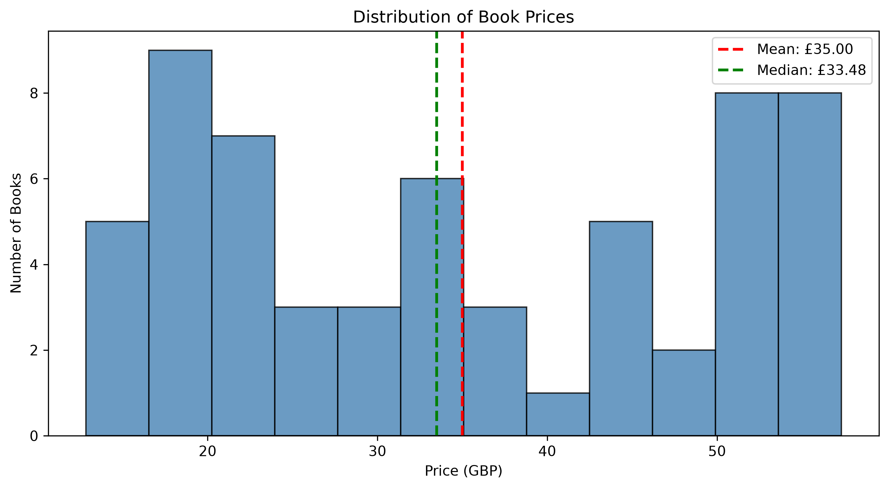
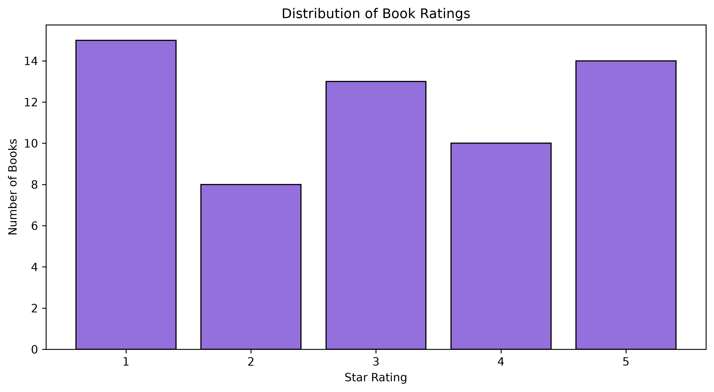
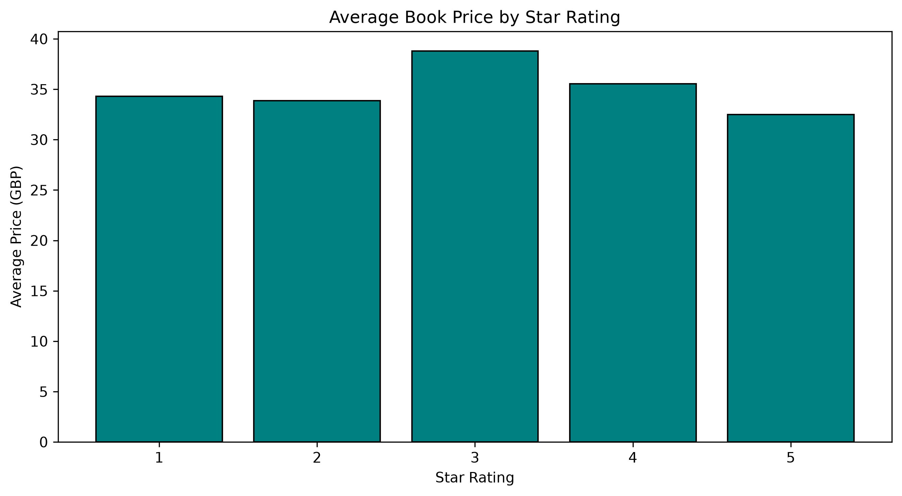

# BookScope: Exploratory Analysis of an Online Book Catalog

## Abstract

BookScope is an educational study of web-based data collection and exploratory data analysis using Python. The project extracts structured book information from [Books to Scrape](https://books.toscrape.com/), transforms the extracted values into an analysis-ready dataset, and examines price distributions, rating frequencies, and the association between price and rating. The current dataset contains 60 books from the first three catalog pages. Prices range from GBP 12.84 to GBP 57.31, with a mean of GBP 35.00. Spearman's rank correlation between price and rating is -0.044, indicating a negligible monotonic association within this sample. As the source contains synthetic data, the results demonstrate analytical methods and do not support conclusions about the commercial book market.

## Research Objectives

The study addresses four questions:

1. How are book prices distributed within the collected sample?
2. Which five books have the highest listed prices?
3. How frequently does each star-rating category occur?
4. Is there an association between book prices and star ratings?

## Data Source and Scope

The dataset is collected from the first three pages of the Books to Scrape catalog, with 20 books per page. This is a sample determined by catalog order; it is not a random sample of the complete catalog.

| Variable | Description | Stored type |
|----------|-------------|-------------|
| `title` | Book title extracted from the product link's title attribute | Text |
| `price` | Listed price in pounds sterling (GBP) | Floating-point number |
| `rating` | Star rating encoded as an integer from 1 to 5 | Integer |
| `availability` | Availability text shown in the catalog | Text |
| `product_url` | Absolute URL of the book's product page | Text |

The source website is intended for web scraping practice. Its prices and ratings are synthetic, and the ratings do not represent verified reader evaluations.

## Methodology

### Data Collection and Transformation

The scraper requests catalog pages using `requests` and parses their HTML with Beautiful Soup. Each request uses a 15-second timeout and checks the HTTP response status. A one-second pause follows each page request.

For each book, the scraper extracts the five variables listed above. Relative product links are resolved to absolute URLs, non-numeric price characters are removed before conversion to floating-point values, and written rating labels are mapped to integers. Duplicate product URLs are removed before the dataset is exported to CSV.

### Data Quality Assessment

The notebook checks missing values, duplicate product URLs, numerical data types, non-positive prices, and ratings outside the permitted range. The saved outputs report:

| Check | Result |
|-------|--------|
| Dataset dimensions | 60 records and 5 variables |
| Missing values | 0 in every variable |
| Duplicate product URLs | 0 |
| Prices at or below zero | 0 |
| Ratings outside 1 to 5 | 0 |
| Numerical types | `float64` for price; `int64` for rating |

All 60 records are retained for analysis. These checks establish completeness and basic numerical validity; they do not verify the accuracy or character encoding of every text field.

### Analytical Approach

The analysis combines descriptive statistics, a price histogram with 12 bins, a ranking of the five most expensive books, rating-frequency analysis, and comparisons of mean and median prices by rating. Spearman's rank correlation is used to explore the monotonic association between price and the ordinal rating variable. The study is descriptive; it does not report a significance test or establish causality.

## Results

### Price Distribution

| Measure | Price (GBP) |
|---------|-------------|
| Mean | 35.00 |
| Median | 33.48 |
| Standard deviation | 14.55 |
| Minimum | 12.84 |
| First quartile | 22.04 |
| Third quartile | 50.14 |
| Maximum | 57.31 |

Prices show substantial variation across the sample. The mean and median differ by GBP 1.52, suggesting limited overall skewness. The histogram nevertheless shows an uneven distribution, with concentrations at lower prices and near GBP 50 or more. Under the selected binning, the most frequent interval is approximately GBP 16.55 to GBP 20.25, containing nine books. The visible pattern depends on the selected bin boundaries.



### Five Most Expensive Books

| Rank | Title | Price (GBP) | Stars |
|------|-------|-------------|-------|
| 1 | Slow States of Collapse: Poems | 57.31 | 3 |
| 2 | Our Band Could Be Your Life: Scenes from the American Indie Underground, 1981-1991 | 57.25 | 3 |
| 3 | The Past Never Ends | 56.50 | 4 |
| 4 | The Pioneer Woman Cooks: Dinnertime: Comfort Classics, Freezer Food, 16-Minute Meals, and Other Delicious Ways to Solve Supper! | 56.41 | 1 |
| 5 | The Secret of Dreadwillow Carse | 56.13 | 1 |

The five highest prices are closely grouped, spanning only GBP 1.18. The highest-priced book exceeds the second-highest by GBP 0.06. Their ratings range from one to four stars, indicating that the most expensive observations do not consistently receive high ratings.

The notebook also generates a [horizontal comparison chart](figures/top_5_expensive.png). Full titles are provided in the table because long labels can constrain the chart layout.

### Rating Distribution

| Stars | Number of books | Share of sample |
|-------|-----------------|-----------------|
| 1 | 15 | 25.0% |
| 2 | 8 | 13.3% |
| 3 | 13 | 21.7% |
| 4 | 10 | 16.7% |
| 5 | 14 | 23.3% |

One-star books form the largest category, followed closely by five-star books. Two-star books are least frequent. All categories are represented, and none accounts for more than one-quarter of the sample.



### Price and Rating Association

| Stars | Number of books | Mean price (GBP) | Median price (GBP) |
|-------|-----------------|------------------|--------------------|
| 1 | 15 | 34.31 | 31.77 |
| 2 | 8 | 33.87 | 35.48 |
| 3 | 13 | 38.81 | 33.29 |
| 4 | 10 | 35.53 | 38.76 |
| 5 | 14 | 32.48 | 29.90 |

Three-star books have the highest mean price, while five-star books have the lowest. The difference between these displayed means is GBP 6.33. Four-star books have the highest median price, showing that group rankings vary with the summary measure.

Spearman's rank correlation is **-0.044**. This value indicates a negligible negative monotonic association in the observed sample. Higher ratings are therefore not consistently associated with higher prices. This result does not exclude every possible form of relationship.



## Project Structure

```text
bookscope-web-scraper/
|-- analysis.ipynb                  # Analysis, saved outputs, and interpretation
|-- scraper.py                     # Collection, transformation, and CSV export
|-- requirements.txt               # Core project dependencies
|-- README.md                      # Study overview and reproduction instructions
|-- data/
|   `-- books.csv                  # Collected sample of 60 books
`-- figures/
    |-- price_distribution.png
    |-- top_5_expensive.png
    |-- rating_distribution.png
    `-- price_by_rating.png
```

## Reproducing the Study

The saved notebook records Python **3.13.3** as its execution environment. Run the following commands from the project root. The examples use Windows PowerShell.

### 1. Prepare the Environment

```powershell
python -m venv .venv
.\.venv\Scripts\python.exe -m pip install -r requirements.txt
.\.venv\Scripts\python.exe -m pip install jupyterlab scipy
```

The requirements file contains Requests, Beautiful Soup, Pandas, Matplotlib, and lxml. JupyterLab is installed separately to run the notebook, and SciPy supports the notebook's Pandas-based Spearman correlation calculation. Dependency versions are currently unpinned.

### 2. Collect the Data, if Required

The supplied CSV can be used directly for analysis. To collect a new snapshot:

```powershell
.\.venv\Scripts\python.exe scraper.py
```

This command requires an internet connection and overwrites `data/books.csv`. The scraper is configured to request catalog pages 1 through 3.

### 3. Run the Analysis

```powershell
.\.venv\Scripts\python.exe -m jupyterlab analysis.ipynb
```

Select the kernel associated with the project environment and run all notebook cells in order. The notebook reads `data/books.csv` and writes the four chart files to `figures/`. Running from the project root is necessary because these paths are relative.

The results documented above correspond to the supplied dataset and saved notebook outputs. A newly collected snapshot may produce different results if the website changes.

## Limitations

- **Sampling scope:** The dataset contains only the first 60 catalog entries. Catalog ordering may affect the observed distributions.
- **Synthetic observations:** Prices and ratings are generated for a practice website and cannot substantiate claims about customer preferences, publishing, or retail pricing.
- **Single snapshot:** The study does not measure changes in price, availability, or ratings over time. The CSV does not include a collection timestamp.
- **Limited explanatory variables:** Categories, authors, publication dates, and other potentially relevant attributes are not collected.
- **Text quality:** Some supplied titles contain character-encoding artifacts. The existing numerical validation does not detect or repair such text issues.
- **Collection robustness:** The scraper depends on the current HTML structure. It checks HTTP errors but does not implement retries, structured logging, or recovery from missing page elements.
- **Reproducibility:** Unpinned dependencies and changes to the source website may affect future execution or outputs.

## Further Development

Future work could extend collection to the complete catalog, extract book categories, record collection timestamps, and validate text encoding. Reproducibility could be improved by pinning dependency versions and recording dataset provenance. Additional engineering work could introduce request retries, structured logging, and explicit checks for missing HTML elements.

## Conclusion

BookScope demonstrates the integration of web scraping, data transformation, validation, descriptive statistics, and visualization in a single Python workflow. The sampled catalog exhibits a broad price range, representation across all five rating categories, and a rank correlation between price and rating that is close to zero. Its principal value is as a reproducible educational exercise in data acquisition and interpretation, subject to the limitations of the source and current implementation.

## Source and Analytical Record

- [Books to Scrape](https://books.toscrape.com/) - source website.
- [Analysis notebook](analysis.ipynb) - methods, saved outputs, and detailed interpretation.
- [Collected dataset](data/books.csv) - observations underlying the reported findings.
